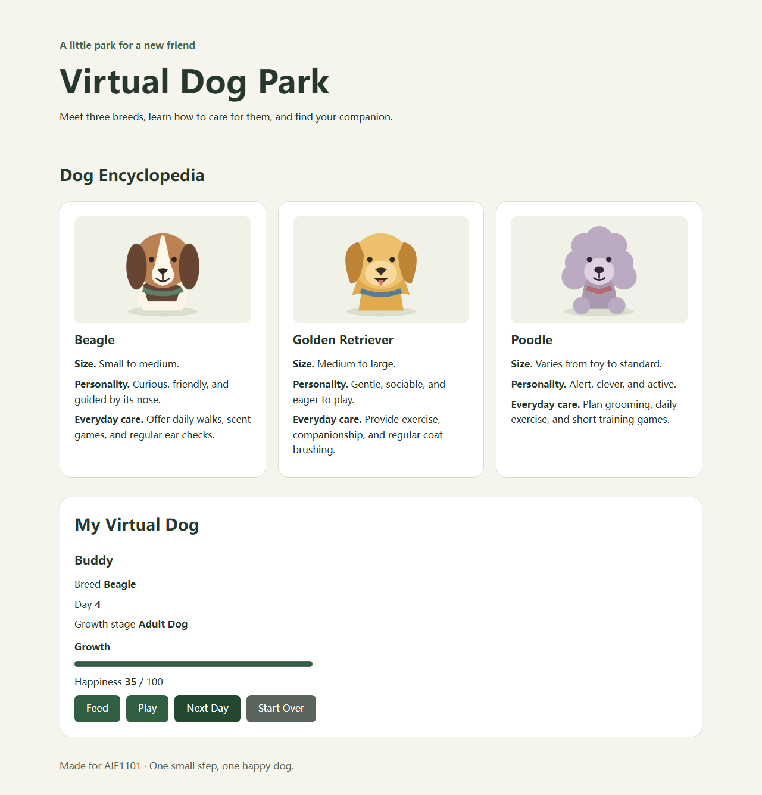

# Virtual Dog Park

A beginner-friendly dog encyclopedia and virtual pet website for AIE1101.
The website uses HTML, CSS, and vanilla JavaScript.

## Preview

Open this project folder in VS Code. Install Live Server by Ritwick Dey,
right-click index.html, and select Open with Live Server.

Alternatively, open PowerShell in this folder and run:

```powershell
python -m http.server 5500 --bind 127.0.0.1
```

Visit http://127.0.0.1:5500 in your browser. Keep the same browser and address
(including the port) when checking saved progress. Stop the server with Ctrl+C.

## Features and rules

- Encyclopedia for Beagle, Golden Retriever, and Poodle, with care notes.
- Three original, project-created SVG illustrations in assets/.
  These are illustrations, not real dog photographs.
- Adopt one dog with a trimmed, non-empty name of up to 20 characters.
  Names are displayed using textContent.
- A new dog starts on Day 1, as a Puppy, with happiness 50.
- Feed and Play each add 10 happiness, up to 100.
- Next Day advances one simulated day and subtracts 5 happiness, down to 0.
- Day 1 is Puppy, Days 2-3 are Young Dog, and Day 4 onward is Adult Dog.
  A growth bar also shows the three stages.
- Refresh restores the latest dog after adoption, Feed, Play, and Next Day.
- Start Over asks for confirmation. Cancel keeps the dog.
  Confirm deletes saved progress and returns to the adoption form.
- Cards stack on a narrow screen.

## Where progress lives

The dog's name, breed, day, and happiness are stored in this browser's
localStorage under virtualDogParkPetV1. Only one dog is stored.
Progress stays on the same browser, device, and website address.
Git and GitHub store the website code. Pet progress stays in the browser.

## How the code works

- index.html provides the content, form, buttons, and growth bar.
- style.css controls spacing, colors, and the narrow-screen layout.
- script.js keeps one dog object. stageFor() applies the growth rules,
  renderDog() updates the page, and saveAndRender() saves each action.
- loadDog() reads saved progress when the page opens.

## Manual browser checklist

- Check three breed entries, three images, and readable care notes.
- Try a blank name, spaces only, a name with surrounding spaces,
  a name containing < and >, and a name longer than 20 characters.
- Adopt Buddy as a Beagle. Check Day 1, Puppy, and happiness 50.
- Click Feed and Play. Check 60, then 70, and a maximum of 100.
- Advance to Days 2, 3, and 4. Check the stage text and three bar lengths.
- Continue advancing days. Check that happiness stops at 0.
- Refresh after adoption and each action. Check the latest saved values.
- Cancel Start Over and refresh. The dog should remain.
- Confirm Start Over and refresh. The adoption form should remain.
- At a narrow width, check the form, cards, and all buttons.

## Development and tests

Each round was browser-tested before its feature commit. The coding assistant
ran automated tests in headless Chrome. Students should also use the manual
checklist above and explain what they observe.

| Round | Feature | Commit |
| --- | --- | --- |
| 1 | Encyclopedia and responsive layout | 730c3e0 |
| 2 | Adoption, names, Feed and Play | 92625c0 |
| 3 | Growth, persistence and confirmed reset | 2ea4ce5 |

The test script is tests/browser-tests.cjs. Local JSON reports and desktop/mobile
screenshots for all three rounds are in tests/results/, which is ignored by Git.
The final page preview below is also included in the repository.

To rerun the final automated checks, use Node.js with Playwright available:

```powershell
npm install --no-save --package-lock=false playwright
node tests/browser-tests.cjs
```

This command installs browser test tooling. Previewing the website only needs
a local server and browser. The tests use the installed Windows Chrome by default.
To use another Chromium browser, set BROWSER_PATH to its executable path first.
Round 1 and 2 test snapshots belong to their corresponding feature commits.
On the final version, run the default Round 3 test.


